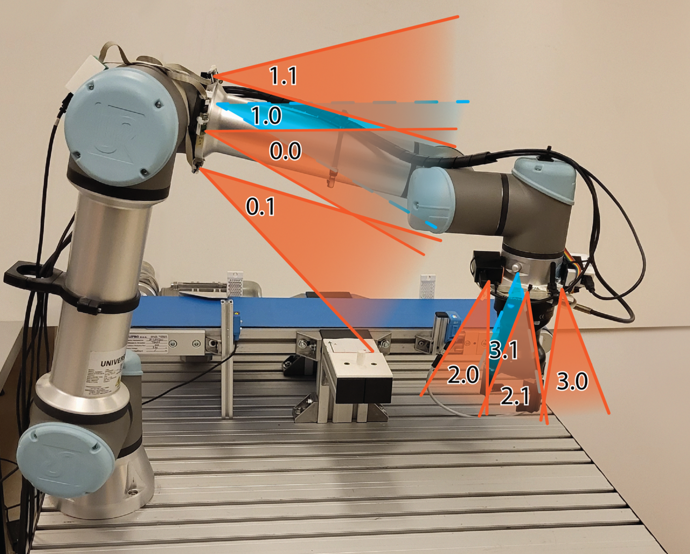
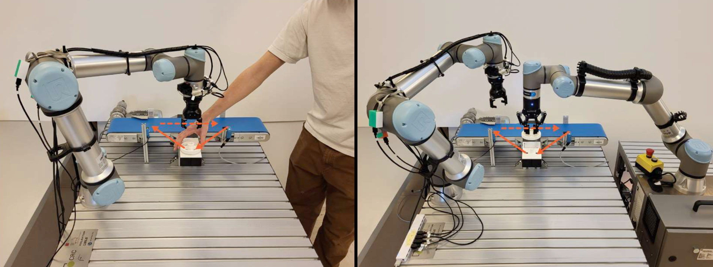
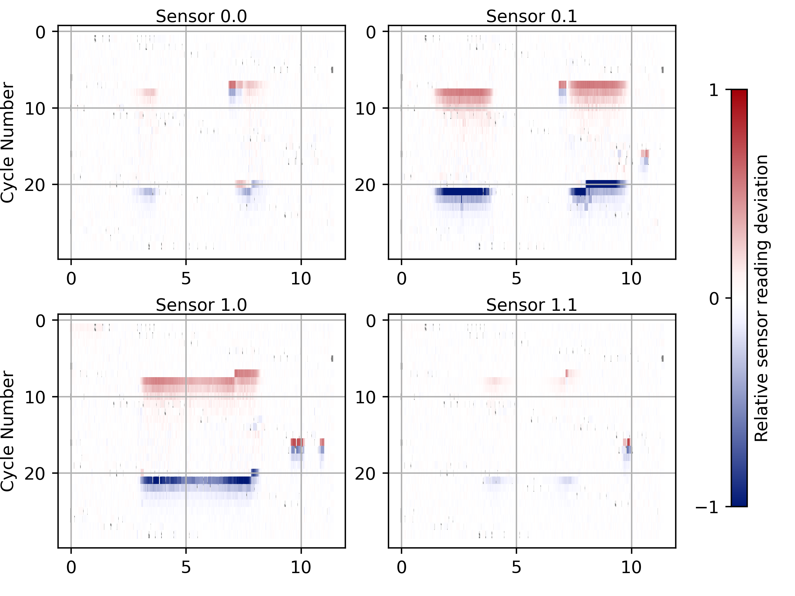

# Adaptive Lidar Envelope Safety System

## Summary

This project implements an on-robot, adaptive lidar safety layer inspired by modern speed-and-separation monitoring principles.
It dynamically builds and updates a reference envelope of expected distances around the robot and detects deviations indicative of obstacles or human intrusion.
The system aligns with the concept of replacing rigid barriers with “soft”, sensor-driven protective fields.

**System Overview**

The following figure shows the full multi-sensor configuration, including per-joint lidar modules and their overlapping fields of view, which together form the adaptive protective envelope:

---

## Key Specs

- **Mounting:** 3D-printed mounting brackets; overlapping FOVs create a multi-perspective distance shell.
- **Processing:** Parallel sensor acquisition threads + a global reference-cycle synchronizer.
- **Adaptation:** Weighted envelope updates informed by environment changes; reference models gradually adjust over multiple execution cycles.
- **Intrusion Detection Latency:** Theoretical minimum ~100 ms.
- **Safety Response:** Real-time speed modulation and restoration through RTDE.
- **Collision Signals:** Force-reference comparison prevents adaptation during impacts.

---

## Performed Tests

The system was validated across several controlled test environments.

### Test Environments

The following images illustrate representative test scenarios, including obstacle placement, conveyor motion, and multi-robot setups:

### Test Results (Adaptation Samples)

Below is a visualization of reference adaptation over repeated cycles. Warmer colors represent higher positive deviations from expected distance, and cooler colors represent negative deviations.

**Test Categories**

- Baseline Functionality: Obstacle Introduction in Controlled Environment  
- Time-Varying Environment: Conveyor Belt  
- Multi-Robot Environment  
- Human-Robot Collaboration Scenario  

For details, see ref.

---

## Detailed Features & Functionality

### Reference System

- Records robot motion reference (optionally with `-r`), consistent with reference-trajectory-driven intrusion detection.
- Records reference lidar images (with `-r`).
- Supports re-loading stored reference envelopes.
- Overfits references to 1000 ms and updates periodically.
- Weighted adaptation gradually incorporates new environmental geometry.
- Randomized intervals avoid spike artifacts.
- Force anomalies block adaptation to maintain reference integrity.

### Cycle Position Calculation

- Computes cycle position using joint states and interpolates the normalized phase of motion.
- Pauses reference time when robot is stationary; resumes upon movement.
- Background thread continuously tracks cycle position and exposes it globally.

### Force Monitoring

- Uses stored force signatures to detect collision events during adaptation windows.
- Disables reference adaptation during contact to prevent contamination.

### Sensor Reading

- Reads multiple Arduinos in parallel and handles sensor error codes.
- Computes deviations from expected distance and checks for repeated anomalies.
- Triggers robot slowdown when intrusions are detected, implementing a “soft fence.”
- Restores full robot speed once the environment returns to expected safe conditions.

---

## Publication

This project marks development that appears as part of the following dissertation:

**Luka Pogačnik, _Lidarski sistem z več vidnimi polji za zagotavljanje varnosti v robotiki_ (2024).**  
Available at: https://repozitorij.uni-lj.si/IzpisGradiva.php?id=161941&lang=eng
